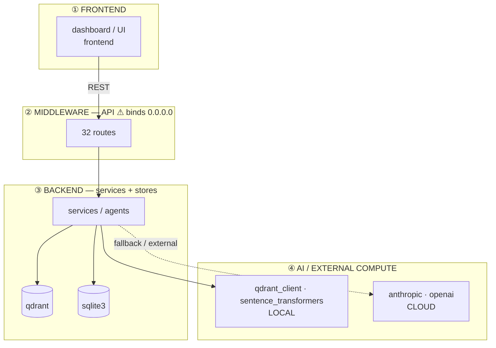
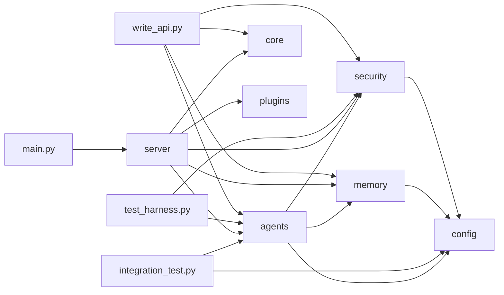
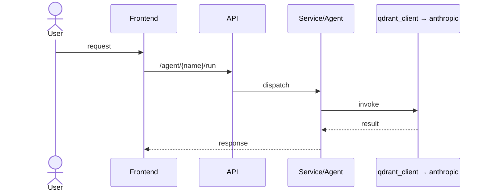
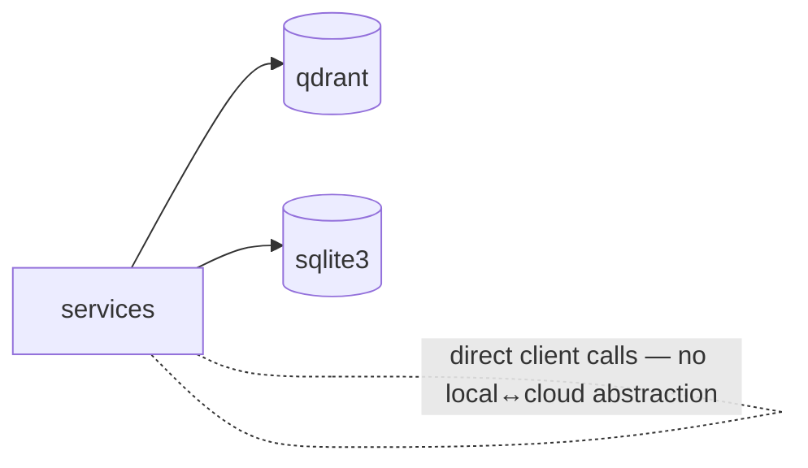

# 🩻 Codebase X-Ray — aicloud

> Generated by **codebase-xray** · target `/Volumes/MiniSSD/proj/aicloud`

```
 scan.py            deterministic
 diagram.py         deterministic
 design_system.py   deterministic
 libs.py            deterministic
 extract-assist     Haiku 4.5
 14 personas × facts Sonnet 4.6
 synthesis + ranking Opus 4.8
 render_report.py   deterministic
```

**Verdict:** 🔴 Ship-blocker present. Sound, genuinely local-first stack undermined by the repo violating its own privacy promise (committed credentials/DBs, 0.0.0.0 bind, Windows-only launch). All red items are low-effort.

---

## 1. Executive Summary

Haven is a local-first private-AI workflow engine (messy text → structured, risk-flagged JSON) at 2,778 LOC. The architecture is coherent — coordinator → router → 7 agents, a privacy/budget/content middleware tier, Qdrant vector memory, and a hand-rolled GitHub-dark dashboard — and the stack choices are correct for the mission (Ollama local + budget-capped Claude + Qdrant). The problem is repo hygiene and platform reach contradicting the pitch: live Gmail credentials, .env, owner PII and 5 databases are committed to git; the server binds 0.0.0.0; one-button launch is Windows-only while the repo runs on macOS. Fix the five red items (all S-effort) and Haven is demo-ready; the higher-value work is a Data-Access Layer and a graceful-fallback path.

## 2. Health Scorecard

| Dimension | Status | Note |
|---|:--:|---|
| Backend | 🟢 | Clean FastAPI + agent router; sensible module split |
| Middleware | 🟢 | privacy → budget → content filter chain is a real strength |
| Frontend | 🟡 | Single hand-rolled dashboard; good theme, no build/tests |
| Cloud integration | 🟢 | Budget-capped Claude fallback; on-brand local-first |
| Reusability | 🟡 | Agents reusable; write_api/write_manager duplicate server/api |
| Portability (Mac/Win/Unix) | 🔴 | .bat-only launch; ai/ venv + .exe installers committed |
| Security / local-first | 🔴 | Credentials, PII & DBs committed; 0.0.0.0 bind |
| Discoverability | 🟡 | README strong; naming split Haven/AiCloud/MyPrivateAI |
| Error handling | 🟡 | 3 bare except; broad catches in agents |
| Boundaries | 🟢 | Healthy; largest file 194 LOC |
| Graceful fallback | 🟡 | No offline / model-down degradation path |
| Data-access layer | 🟡 | Direct Qdrant + sqlite3 calls; no local↔cloud seam |
| Usability / one-button | 🔴 | One-button works on Windows only |
| Expandability | 🟢 | Plugin manifest + agent registry are real extension points |
| Observability / self-heal | 🟡 | /health exists; no metrics; preflight unexposed |

## 3. Architecture Diagrams

> Auto-generated from the import graph + route table — **$0 tokens**.

### Layered Flow — Frontend → Middleware → Backend → Cloud



### Component / Import Graph



### Request Workflow (Sequence)



### Data-Access / Local-First Flow




## UI Design & Design System

> Extracted from frontend files — **$0 tokens**.

**Detected framework:** none (hand-rolled)  
**Frontend files:** 3  
**Typography:** `-apple-system,BlinkMacSystemFont,'Segoe UI',sans-serif`

### Color Tokens

| Color | Uses |
|---|--:|
| `#6B7280` | 7 |
| `#E2E6EF` | 7 |
| `#1A56DB` | 6 |
| `#27C93F` | 6 |
| `#FFBD2E` | 4 |
| `#F85149` | 4 |
| `#0D1117` | 3 |
| `#9CA3AF` | 3 |
| `#79C0FF` | 3 |
| `#F8F9FC` | 2 |
| `#1F2937` | 2 |
| `#E6EDF3` | 2 |

### Component Classes

`card` · `sc-btn` · `full` · `card-lbl` · `card-val` · `ci` · `cih` · `cil` · `doc` · `doc-hdr` · `copy-btn` · `doc-body` · `${v.status}` · `yellow`

### UI → API wiring (fetch calls)

`http://localhost:8000/intake/run`


## Libraries & Dependency Inventory

> Derived from imports + manifests — **$0 tokens**.

| Library | Layer | Local/Cloud | Note |
|---|---|:--:|---|
| **uvicorn** | ASGI server | local |  |
| **google_auth_oauthlib** | Auth | cloud | OAuth |
| **google** | Cloud SDK | cloud | Google |
| **googleapiclient** | Cloud SDK | cloud | Google APIs |
| **dotenv** | Config | local | env vars |
| **yaml** | Config | local | pyyaml |
| **yfinance** | Data API | cloud | finance |
| **sentence_transformers** | Embeddings | local |  |
| **watchdog** | Filesystem | local | file watch |
| **httpx** | HTTP client | both | async-capable |
| **anthropic** | LLM (cloud) | cloud | Claude |
| **openai** | LLM (cloud) | cloud | GPT |
| **storage** | Library | ? |  |
| **spacy** | NLP | local |  |
| **trafilatura** | Scraping | cloud | web extract |
| **sqlite3** | Storage | local | stdlib |
| **pydantic** | Validation | local |  |
| **qdrant** | Vector DB | local | native dep |
| **qdrant_client** | Vector DB | local | native dep |
| **fastapi** | Web framework | local | async, typed |

## Competitive Tech-Stack Analysis

| Layer | Current | Alternatives | Pros | Cons | Recommendation |
|---|---|---|---|---|---|
| Local LLM | Ollama (3B/8B) | LM Studio, llama.cpp, vLLM | simple, $0, on-brand | 3B/8B weak for legal/finance extraction | Keep; add Qwen2.5-7B/14B quality tier |
| Cloud fallback | Claude Haiku (capped) | GPT-4o-mini, Gemini Flash | cheap, strong, budget-guarded | single-vendor; stray openai import | Keep Claude, remove OpenAI |
| Vector DB | Qdrant (embedded) | Chroma, LanceDB, sqlite-vss | fast, production-grade | heavy here; native dep | Hold; eval LanceDB for portability |
| API | FastAPI | Flask, Litestar | async, typed, great DX | none material | Keep — ideal fit |
| Frontend | Vanilla JS + inline CSS | React, Svelte, HTMX | zero build, instant | no components/tests; ceiling near | HTMX now → Svelte if it grows |
| Packaging | PyInstaller + .bat | Tauri, Briefcase, Docker | one-file Win exe | Windows-only; ships .exe in repo | Add Docker + shell; eval Tauri |

## Prioritized Recommendations

| # | Rec | Impact | Effort | Owners | Evidence |
|:--:|---|:--:|:--:|---|---|
| **1** 🔴 | Purge committed secrets/DBs from git history; rotate Gmail creds | Critical | S | Security, Support | git ls-files: gmail_credentials.json, gmail_token.json, .env, *.db ×5 |
| **2** 🔴 ⚡ | Default bind 127.0.0.1; make 0.0.0.0 an opt-in flag | Critical | S | Security, Architect | main.py:12, launcher.py:70, Dockerfile:10 |
| **3** 🔴 ⚡ | Add start.sh/stop.sh + cross-platform launcher | High | S | Portability, UX | only .bat scripts; repo runs on darwin |
| **4** 🔴 ⚡ | Stop committing ai/ venv + .exe installers | High | S | Portability, Engineer | committed_venv=true; git-installer.exe, python-installer.exe |
| **5** 🟠 | Remove/gate stray OpenAI import behind local-first toggle | High | M | Security, PM, Marketing | haven_demo.py imports openai vs local-first pitch |
| **6** 🟠 ⚡ | Introduce a Data-Access Layer (local↔cloud pluggable) | High | M | Architect, Data | direct QdrantClient/sqlite3 across 5 files |
| **7** 🟠 ⚡ | Graceful fallback when model/network down | Med | M | Error-handling, Support | no degradation path; 3 bare except |
| **8** 🟡 ⚡ | Unify branding Haven / AiCloud / MyPrivateAI | Med | S | PM, Marketing, Sales | README vs Start AiCloud.spec vs Start MyPrivateAI.spec |
| **9** 🟡 ⚡ | Expose preflight as /health + metrics | Med | S | Observability | core/preflight.py unexposed |
| **10** 🟡 ⚡ | Replace bare except; add CI | Med | M | Engineer, QA | 3 bare except; thin tests, no CI config |

## Parallelization Plan

```
WAVE A — sequential (rewrites git history, run alone)
  └─ Rec 1: secret purge + history rewrite + credential rotation

WAVE B — parallel ⚡ (independent file sets)
  ├─ feature/bind-localhost      (Rec 2)  → main.py, launcher.py, Dockerfile
  ├─ feature/cross-platform-run  (Rec 3,4) → start.sh, .gitignore
  ├─ feature/health-endpoint     (Rec 9)  → server/api.py
  └─ feature/branding-unify      (Rec 8)  → README, *.spec, dashboard.html

WAVE C — parallel ⚡ (after B lands)
  ├─ feature/data-access-layer   (Rec 6)  → core/, memory/, security/, storage/
  └─ feature/graceful-fallback   (Rec 7)  → agents/router.py, coordinator.py
```
Kickoff: start Wave B's four branches in parallel: bind-localhost, cross-platform-run, health-endpoint, branding-unify

## Per-Perspective Findings

<details><summary><b>🔒 Security / local-first</b> (Sonnet 4.6)</summary>

- 🔴 **Committed live credentials** — Gmail OAuth creds + token tracked; existential trust break for a privacy product `security/gmail_credentials.json`
- 🔴 **Databases & PII in repo** — budget/finance/email/research DBs + owner name/city in config.yaml `config.yaml, security/*.db`
- 🔴 **0.0.0.0 bind** — LAN-exposed by default; commit advertises 10.0.0.177:8000 `main.py:12`

</details>

<details><summary><b>🧭 Architect</b> (Sonnet 4.6)</summary>

- 🟡 **No data-access abstraction** — QdrantClient/sqlite3 instantiated directly; blocks 'cloud or local server' goal `memory/, security/, logs/`
- 🟡 **Duplicate API surface** — write_api.py/write_manager.py overlap server/api.py `write_api.py:124`

</details>

<details><summary><b>🧱 Portability</b> (Sonnet 4.6)</summary>

- 🔴 **Windows-only launch** — only .bat + PyInstaller .spec; repo runs on macOS `start.bat, Start AiCloud.spec`
- 🔴 **Committed venv + installers** — ai/ venv and 26MB python-installer.exe tracked `committed_venv=true`

</details>

<details><summary><b>🎨 Usability / UX</b> (Sonnet 4.6)</summary>

- 🟡 **Tokens inlined, color-only status** — extract to tokens.css; add colorblind-safe icons; no responsive rules `server/dashboard.html`

</details>

<details><summary><b>🩺 Observability / self-healing</b> (Sonnet 4.6)</summary>

- 🟡 **preflight unexposed** — good self-check seed; surface as /health + metrics for the dashboard to poll `core/preflight.py`

</details>


## Model & Cost Breakdown

| Phase | Model | In | Out | Cost | Wall |
|---|---|--:|--:|--:|--:|
| scan.py | deterministic | 0 | 0 | $0.0000 | 1.2s |
| diagram.py | deterministic | 0 | 0 | $0.0000 | 0.4s |
| design_system.py | deterministic | 0 | 0 | $0.0000 | 0.2s |
| libs.py | deterministic | 0 | 0 | $0.0000 | 0.2s |
| extract-assist | Haiku 4.5 | 12,400 | 1,900 | $0.0219 | 4s |
| 14 personas × facts | Sonnet 4.6 | 134,000 | 30,800 | $0.8640 | 41s (3 waves) |
| synthesis + ranking | Opus 4.8 | 34,600 | 4,900 | $0.8865 | 23s |
| render_report.py | deterministic | 0 | 0 | $0.0000 | 0.4s |
| **TOTAL** | **3 models** | **181,000** | **37,600** | **$1.77** | |

**Total: $1.77** · deterministic phases cost $0.

## Appendix: Scan Facts

```
files            : 94
total LOC        : 2,778
languages        : .py×41, .yaml×7, .bat×3, .html×3, .yml×1
routes           : 32
import edges      : 19
vector db        : qdrant
cloud sdks       : anthropic, openai
local ai         : qdrant_client, sentence_transformers
committed secrets: .env, budget.db, check_secrets.py, logs/ledger.db, security/email_log.db, security/finance_log.db
network binds    : Dockerfile:10, launcher.py:70, main.py:12
committed venv   : True
committed bins   : git-installer.exe, python-installer.exe
shell scripts    : none
bat scripts      : shutdown.bat, start.bat, startup.bat
bare except      : 3
todo/fixme       : 0
```

---
_Generated by codebase-xray. Deterministic scripts (scan, diagram, design_system, libs, render) — $0 tokens._